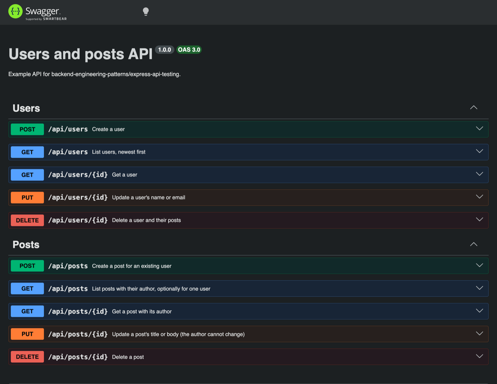

# Express API testing

An Express and MongoDB API with integration tests against a real MongoDB, consistent error handling, coverage thresholds, and CI. 33 tests cover every endpoint and error path, with 100% line coverage, in under a second.



## What it shows

- **An app you can test without side effects.** [`src/app.js`](src/app.js) builds the Express app; [`src/server.js`](src/server.js) connects to MongoDB and listens. Tests import the app directly: no port, no second database connection.
- **Integration tests against a real MongoDB, with no setup.** [`test/setup.js`](test/setup.js) starts an in-memory `mongod` (the real server binary, not a mock) for the whole run and empties the collections after each test. Set `TEST_MONGO_URL` to run the same tests against your own MongoDB.
- **Errors as part of the API.** One error handler ([`src/errors.js`](src/errors.js)) gives every failure the same shape, `{ "error": { "code", "message", "details" } }`, with the right status. The tests check each case, including that database internals never reach the client.
- **Quality gates in CI.** A GitHub Actions workflow lints, checks formatting, and runs the tests with coverage on Node.js 22 and 24. It fails if coverage drops below the thresholds in [`.c8rc.json`](.c8rc.json).

## How it works

```text
test/*.test.js ──► createApp() ──► routes/users.js, routes/posts.js ──► Mongoose models ──► mongod
     │                                  │                                                (in-memory, or TEST_MONGO_URL)
     │                                  └── errors are thrown, not answered inline ──► errorHandler ──► { error: { code, message } }
     └── test/setup.js: start mongod once, build indexes, empty collections after each test
```

| Situation                                    | Status | `error.code`                                                            |
| -------------------------------------------- | ------ | ----------------------------------------------------------------------- |
| Missing or invalid fields (create or update) | 400    | `validation_failed`, with `details` per field                           |
| Malformed id (`/api/users/not-an-id`)        | 400    | `invalid_id`                                                            |
| Body is not valid JSON                       | 400    | `invalid_json`                                                          |
| Post for a user that does not exist          | 400    | `unknown_user`                                                          |
| No such record or route                      | 404    | `not_found`                                                             |
| Email already taken (any letter case)        | 409    | `duplicate`                                                             |
| Anything unexpected                          | 500    | `internal_error`, with a generic message; the real error is only logged |

Also:

- **Allowed fields only.** Each route accepts only its listed fields. A client cannot set `createdAt`, `isAdmin`, or a post's author on update.
- **Validation on updates too.** Updates run Mongoose validators (`runValidators`).
- **Stable ordering.** Lists sort newest first, with `_id` as a tie-breaker.
- **Cascading delete.** Deleting a user deletes their posts.
- **API docs.** The OpenAPI 3 spec is built from `@openapi` comments next to each route ([`src/docs/openapi.js`](src/docs/openapi.js)) and served at `/api/docs` (Swagger UI) and `/api/docs.json`. A test checks that all ten routes are documented.

## Run it

Requirements: Node.js 22 or newer. Docker only if you want to run the server against a local MongoDB.

```bash
npm ci                    # also downloads the MongoDB 8.0.38 binary for the tests (about 190 MB, once)
npm test                  # 33 tests
npm run test:coverage     # the same, with a coverage report and thresholds
```

To run the server:

```bash
docker compose up -d      # MongoDB 8.0.38 on localhost:27018
npm start                 # http://localhost:4000, docs at /api/docs
```

```bash
curl -s -X POST localhost:4000/api/users -H 'Content-Type: application/json' -d '{"name":"Asha Rao","email":"Asha@Example.com"}'
```

Formatting is checked with Prettier (`npm run format:check`, or `npm run format` to fix). Linting uses the repository's shared ESLint config: run `npm install && npm run lint` at the repository root.

## Configuration

| Variable         | Default                                 | What it does                                                                                                                                              |
| ---------------- | --------------------------------------- | --------------------------------------------------------------------------------------------------------------------------------------------------------- |
| `PORT`           | `4000`                                  | Port for `npm start`                                                                                                                                      |
| `MONGO_URL`      | `mongodb://localhost:27018/express_api` | The server's database                                                                                                                                     |
| `TEST_MONGO_URL` | (unset)                                 | Run the tests against this MongoDB instead of an in-memory one. The tests empty the `users` and `posts` collections, so point it at a throwaway database. |

The in-memory MongoDB version is pinned in `package.json` (`config.mongodbMemoryServer.version`), to the same version as `docker-compose.yml`.

## What you'll see

Recorded on 2026-11-15 on an Apple silicon Mac with Node.js 24.16.0:

```text
  33 passing (572ms)

-------------|---------|----------|---------|---------|-------------------
File         | % Stmts | % Branch | % Funcs | % Lines | Uncovered Line #s
-------------|---------|----------|---------|---------|-------------------
All files    |     100 |     98.3 |     100 |     100 |
 src         |     100 |    89.47 |     100 |     100 |
  app.js     |     100 |      100 |     100 |     100 |
  errors.js  |     100 |    92.85 |     100 |     100 | 41
 ...
```

- **Against Docker MongoDB:** the same 33 tests passed with `TEST_MONGO_URL` pointing at MongoDB 8.0.38 in Docker.
- **On Node.js 22 and x86_64 Linux:** the CI steps (`npm ci`, format check, tests with coverage), run in a `node:22-bookworm` container (Node.js 22.23.5, emulated x86_64), also passed all 33 tests with the same coverage.
- **Uncovered branch:** the one left (`errors.js` line 41) is the fallback for a duplicate-key error without key details, which MongoDB did not produce in these tests.
- **Coverage scope:** `src/server.js` (connect and listen) is excluded from coverage. Every endpoint is tested through `createApp()`.

## Limitations

- **No authentication or authorization.** Anyone can create, change, or delete any record. A real API needs both, and tests for both.
- **No pagination.** List endpoints return every record. Ordering is already stable (`createdAt`, then `_id`), which is what cursor pagination needs.
- **One MongoDB per test run, emptied after each test.** That keeps tests independent, but they cannot run in parallel. Parallel runs need a database per worker.
- **Known advisories.** `npm audit` reports moderate advisories in `glob` and `minimatch`, used by the test tools (`mocha`, `c8`) and by `swagger-jsdoc`, which only use them to match fixed file paths at startup. The fixes npm suggests are downgrades.
- **No ARM Debian binary.** MongoDB publishes no ARM build for Debian 12, so the in-memory server does not start in `node:*-bookworm` containers on ARM machines. Ubuntu, macOS, and x86_64 Linux are fine. Set `TEST_MONGO_URL` elsewhere.

## Background

This example started as [app-with-test-cases](https://github.com/SnehalAgrawal/app-with-test-cases) (2025). As published, neither its server nor its tests could start: `postController.js` imported `../models/Post` without the `.js` extension, which Node.js ES modules require. It was rebuilt in November 2026:

- **Structure.** The app and server were split, so tests no longer open a port and connect at import time.
- **Errors.** Error handling was centralised. Invalid ids returned 500 and duplicate emails returned MongoDB's raw `E11000` text.
- **Validation and fields.** Updates are now validated and accept only allowed fields.
- **Versions.** Current pinned versions: Express 5.3, Mongoose 9.11, Mocha 12, Chai 6. Mongoose options that current drivers reject (`useNewUrlParser`, `useUnifiedTopology`) were dropped.
- **Coverage and CI.** Coverage thresholds and a CI workflow were added, replacing a SonarQube configuration that needed a server.

Two problems were found while rebuilding and are fixed in the code:

- **Unstable list order.** "Newest first" sorted only by `createdAt`, so records created in the same millisecond came back in random order.
- **Port clash.** The local MongoDB used port 27017, which clashed with an existing MongoDB on the test machine. It now uses 27018.
